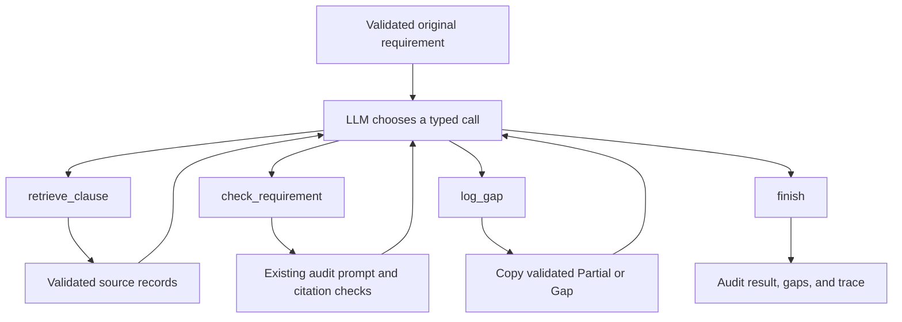

# Tool-calling compliance agent

The agent wraps the existing NASA RAG baseline. A local LLM selects a tool, receives its result, and selects the next tool until it finishes or reaches the step limit. The original requirement remains fixed throughout the run. This implements [issue 15](https://github.com/Break-Through-Tech/Aerospace-1C-compliance-copilot/issues/15).

## Run

Use Python 3.10 or newer and the existing `requirements.txt`. No hosted API key or new runtime dependency is required. The first run downloads the embedding model and Qwen3-4B-Instruct-2507 weights. CPU is supported but slower; CUDA or Apple MPS is selected when available.

```bash
python -m venv .venv-rag
source .venv-rag/bin/activate
pip install -r requirements.txt
python scripts/run_agent_demo.py
python scripts/summarize_rag_run.py outputs/agent/demo.json --output outputs/agent/demo-summary.json
```

The default demo audits NASA-SR-001, NASA-SR-002, and NASA-SR-005. The initial controller prompt excludes the benchmark identifier, and the audit prompt uses the requirement text and retrieved sources. Expected verdicts, assigned reference IDs, and benchmark rationales are used only by the separate scoring script. After checking, tool observations include the requirement identifier for traceability; the verdict can no longer change. Use `--ids NASA-SR-003 NASA-SR-010` to select cases or `--all` for the development benchmark. `--output` selects the result path. `--model-revision` and `--embedding-revision` pin model commits; the resolved revisions, package versions, and source hashes are saved in each report.

`--backend` chooses `local` (the default) or `api`. Local mode loads Qwen and does not read API settings. API mode uses the hosted generator for both the controller and the audit prompt, and it does not load Qwen. `--max-requests`, `--period-seconds`, and `--max-attempts` configure that hosted quota and do not wrap local Qwen. See [Optional hosted API generator](api-generator.md).

`--cache` stores identical retrieval and generation calls in `outputs/cache/generation_cache.json`. It is off by default, and `--cache-path` is ignored without it. The same wrapped generator is both the audit model and the controller. See [Optional response cache](caching.md).

`--batch-size 10` audits requirements through the sequential batch runner and saves after each chunk. Omit it to keep the original per-requirement loop. `batch_size` groups finished rows; it does not merge prompts or run the local model concurrently. See [Batch audits](batching.md).

[Agent_Audit_Demo.ipynb](../notebooks/Agent_Audit_Demo.ipynb) displays the saved evidence and can optionally run the model locally or in Colab. Live Colab execution has not been verified.

## Tools and ownership

| Tool | Arguments | Behavior |
| --- | --- | --- |
| `retrieve_clause` | `{}` initially; optional `{"query": "search text"}` afterward | Calls `AuditPipeline.retrieve` with the configured top_k. Validates IDs, metadata, count, and uniqueness; stores the complete source records in the current run. A later search replaces earlier context. |
| `check_requirement` | `{}` | Calls `AuditPipeline.check_requirement` once against the original requirement and current retrieved records. Reuses the baseline comparison prompt, strict JSON schema, and exact source citation resolution. Performs no additional retrieval. |
| `log_gap` | `{}` | Copies a validated Partial or Gap audit into a structured gap record. The model cannot supply its own verdict, quote, ID, or reasoning. Repeated logging returns the same record. |
| `finish` | `{}` | Terminates only after a successful check and, for Partial or Gap, a successful log. |

`finish` is a terminal control action. The three project tools use a strict application-level JSON protocol, not a provider-specific function-calling API. The controller returns one object such as `{"tool":"check_requirement","arguments":{}}`. It actually decides which calls to make; there is no hidden fixed pipeline call that bypasses its choices. The application enforces the valid ordering and supplies the schema for currently available calls on every turn. Before the first retrieval the schema permits only `retrieve_clause` with empty arguments; subsequent retrieval may refine the query.

The first retrieval uses the complete original requirement, preserving the baseline search input. An attempt to rewrite that first query is rejected. The controller can refine a retrieval query afterward, before checking, including after empty retrieval. After a successful check, retrieval and further checks are rejected to prevent context changes invalidating a verdict or staged gap. Invalid calls and audit failures terminate explicitly rather than silently substituting a baseline result.



## Python interface

```python
from compliance_copilot import AuditPipeline
from compliance_copilot.agent import AuditAgent
from compliance_copilot.generation import LocalGenerator
from compliance_copilot.retrieval import build_retriever

model = LocalGenerator()
pipeline = AuditPipeline(build_retriever(project_root), model, top_k=10)
agent = AuditAgent(pipeline, model, max_steps=8)
run = agent.audit("my-requirement", "The project manager shall ...")
print(run.termination)
print(run.result.model_dump())
```

Both `controller` and `pipeline.generator` use a callable accepting chat messages and returning text. They can share one model instance, as in the demo, or use separate callables. Each run keeps its context, audit, gaps, and trace locally, so an `AuditAgent` can be reused sequentially without carrying state between requirements. Concurrent calls require thread-safe underlying model/retrieval callables; the bundled local model is not advertised as thread-safe.

### Reporting integration

`AgentResult` contains:

- `result`: the existing `AuditResult` schema, unchanged.
- `termination`: `finished`, `controller_error`, `invalid_tool_call`, `tool_error`, `audit_error`, or `step_limit`.
- `gaps`: zero or one `GapRecord`, with the original requirement ID/text and exact validated `AuditVerdict`. A completed Meets result has no gaps. Failed runs commit no gaps, even if one was staged before failure.
- `steps`: ordered controller outputs and tool observations. Retrieval observations preserve the actual source records and check observations preserve audit output.

The CLI provides `results` in the baseline scoring script's format and `runs` containing the complete `AgentResult` evidence. A failed agent never exports a successful result just because its check succeeded earlier. Invalid calls, ordering failures, and exhausted step budgets map to `invalid_output` in the compatible baseline result. Controller exceptions use `generation_error`, and retrieval failures use `retrieval_error`. The `termination` and `error_message` fields identify the agent failure. Audit failures preserve their original baseline error codes. Renderers should inspect both `result.status` and `termination` and must not treat an error as a Gap verdict.

This JSON is an integration artifact. Full team JSON/Markdown report design remains the reporting task. No callback sends, uploads, or publishes gaps.

### Caching and batching integration

The demo can wrap the controller and retriever with the optional JSON cache. Cache keys include the ordered messages and generation settings, or the query, top_k, corpus hashes, and embedding settings. Cached text still goes through audit validation. `--batch-size` calls `AuditAgent.audit` once per requirement, in order, on this thread. Agent failures stay in `results` and `runs`. Failures before an `AgentResult` exists are listed in `batch_errors` and are not given a verdict. `--backend api` places `RateLimitedCallable` around the hosted client and inside the cache. Local Qwen is not rate limited. See [API rate limiting](rate-limiting.md).

## Limits and verification

Default maximum: eight controller calls plus at most one audit-generation call. Each local generation is capped at 768 new tokens. `max_steps` accepts 1 through 32. This bounds the number of calls, not wall-clock time; cancellation/timeouts for a remote or hanging backend belong in its callable adapter.

Source text is untrusted data in both prompts. Strict tool dispatch prevents arbitrary tool execution, invented gap fields, and calls against an alternative requirement. Prompt injection resistance and citation membership do not prove semantic compliance correctness. The baseline's known reasoning errors can remain, and a controller can fail to choose valid actions. Benchmark examples are development cases, not an independent holdout.

Query refinement replaces the baseline context and can change the resulting verdict. For comparisons, inspect the last `retrieve_clause` step's `observation.query` and clause records; the saved demo uses no refinements. A `no_relevant_clause` answer from the audit model ends the run as `audit_error` with `no_context`, rather than triggering another search. Controller history also retains earlier observations and repeats source records after checking, so prompt length grows within the step budget.

```bash
python -m pip install pytest nbformat nbclient ipykernel
python -m pytest -q
RUN_RETRIEVAL_TESTS=1 RUN_MODEL_TESTS=1 python -m pytest -q
RUN_AGENT_MODEL_TESTS=1 python -m pytest tests/test_agent_model_integration.py -q
```

Tests cover all three verdicts, exact source citations, original-requirement preservation, context replacement, empty retrieval, invalid calls/order, repeated logging, explicit failures, exhausted budgets, and isolation between runs. The model integration test checks actual tool execution and valid grounded output rather than claiming every expected benchmark verdict is correct.

## Saved local result

The saved demo uses three existing development examples, with real local retrieval, controller calls, and audit inference. All three finish successfully. Each starts with `retrieve_clause` using the original requirement, then calls `check_requirement`; the two Gap outputs also call `log_gap` before `finish`.

| Measure | Result |
| --- | --- |
| Completed agent runs | 3/3 |
| Valid outputs | 3/3 |
| Expected clause retrieved | 3/3 |
| Expected clause cited | 2/3 |
| Expected verdict matched | 2/3 |
| Both verdict and expected clause matched | 1/3 |

The scorer's valid-output count measures completed agent results, not just audit-model schema compliance. An orchestration failure lowers this count even if an earlier audit passed its schema checks. Group `runs` by `termination` when distinguishing controller failures from audit failures; the compatible `invalid_output` code alone does not distinguish them.

These numbers validate integration, not an accuracy improvement. NASA-SR-002 cites a different retrieved clause while returning the expected Gap label; NASA-SR-005 returns Gap instead of the benchmark's Partial. Both are semantic limitations of the reused audit model. No benchmark labels were changed. See [the full trace](../outputs/agent/demo.json) and [the scored results](../outputs/agent/demo-summary.json). The demo preserves failure and mismatch evidence rather than treating schema validity as semantic correctness.
