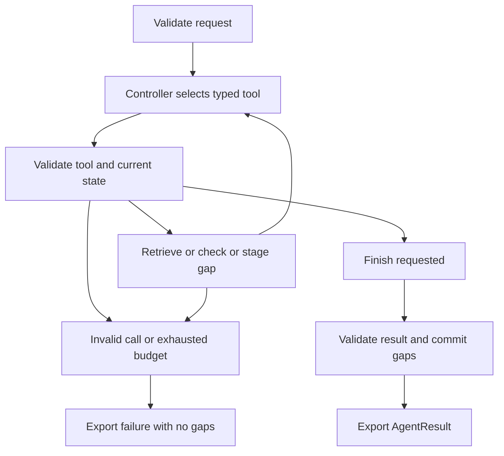

# December Stretch Goals: Research and Implementation Plan

**Alan Guo | Aerospace 1C | November 6, 2026**

## 1. Assignment and recommendation

The December planning tab assigns Alan the task **"Create document/list for stretch goals"**, with a team target of **November 7**. It names LangGraph multi-agent refactoring and cross-standard generalization as candidate directions. This report completes that research and planning deliverable. The experiments below are proposed future work, not implemented features. [Team planning document](https://docs.google.com/document/d/1EyS-S-pRk_NSrJO-ZAJ8IUUMfosLb5j_56Ti69eIWFU/edit?tab=t.pn9rw4kyralm)

My recommendation is to finish the paired Baseline vs. Agent evaluation first, then try a small LangGraph refactor that preserves the current agent's behavior. A second agent should be added only if the error analysis identifies a specific problem it could address. Cross-standard support is a separate, larger experiment because the current data model and audit rules assume NASA NPR 7150.2D.

| Priority | Candidate | Intended outcome | Estimated effort |
| --- | --- | --- | --- |
| 1 | G1: LangGraph orchestration | Make control flow explicit while preserving existing audit results and failure handling | 6 to 10 hours |
| 2 | G2: Specialist-agent experiment | Test whether a separate evidence reviewer reduces a documented error pattern | 8 to 14 additional hours |
| 3 | G3: Second-standard pilot | Prove that retrieval and citations can remain correct outside NASA's SWE identifier format | 12 to 20 hours |
| Later | Report viewer | Help users inspect requirements, citations, gaps, and errors | Estimate after report schema review |

These are planning estimates for implementation and tests, not measured durations or new commitments. G2 depends on G1 and the team's error analysis. G3 can be explored independently after the shared evaluation is stable. A viewer and hosted deployment remain later options.

### What belongs to the other workstreams

Nam and Shahreen own the quantitative comparison. Garima and Meryum own qualitative error analysis. Their research is already in `research/`. GitHub issue 23 and issue 22 remain open; PR 27 adds a comparison notebook and was open at the time of review. This report does not replace those deliverables or claim their results. [Evaluation issue](https://github.com/Break-Through-Tech/Aerospace-1C-compliance-copilot/issues/23), [error-analysis issue](https://github.com/Break-Through-Tech/Aerospace-1C-compliance-copilot/issues/22), [PR 27](https://github.com/Break-Through-Tech/Aerospace-1C-compliance-copilot/pull/27)

<!-- pagebreak -->

## 2. What the repository already supports

Inspected base: `c8c73c4`, the `main` head fetched November 6. All proposed paths below are relative to the repository. Existing implementation evidence is linked to this immutable [source snapshot](https://github.com/Break-Through-Tech/Aerospace-1C-compliance-copilot/tree/c8c73c4).

| Existing component | Useful capability | Constraint for stretch work |
| --- | --- | --- |
| `compliance_copilot/agent.py` | Typed retrieve, check, log, and finish calls; bounded controller loop; traces | State and transitions are inside `AuditAgent.audit`; preserve the ordering checks |
| `compliance_copilot/pipeline.py` | Separate `retrieve()` and `check_requirement()` stages; source-resolved citations | Prompt and citation handling assume NASA obligations and SWE IDs |
| `compliance_copilot/schemas.py` | Strict Pydantic records; explicit successful and failed results | Clause, citation, and decision identifiers require `SWE-` plus three digits |
| `compliance_copilot/retrieval.py` | MiniLM embeddings, FAISS retrieval, reviewed clause text | Reads fixed NASA paths and applies NASA-specific text normalization |
| `compliance_copilot/cache_integration.py` | Cache keys include settings and corpus hashes | Corpus file list is fixed; a new standard needs a distinct identity |
| `scripts/run_agent_demo.py` and `scripts/summarize_rag_run.py` | Saved traces, provenance, and comparison fields | Inputs and expected citations come from the NASA development benchmark |

The current agent already performs model-directed tool selection. Moving it into LangGraph would change its orchestration, not turn a non-agentic pipeline into an agent for the first time.

### Evidence that sets the starting point

The benchmark validator passed on the inspected base: **50 requirements, 44 unique SWE IDs, 50 matching citation mappings, and recorded file hashes checked**. These checks establish structure and provenance, not the correctness of every judgment.

The saved RAG run has 50 valid outputs, 37 matching verdicts, and 35 matching verdict-and-citation pairs out of 50. The saved agent demo has three valid outputs, two matching verdicts, and one matching verdict-and-citation pair out of three. The different sample sizes and run configurations prevent a fair performance comparison. These are saved development results, not fresh inference or holdout results. [RAG quality notes](../docs/rag-quality-check.md), [RAG summary](../outputs/rag/audit-results-summary.json), [agent summary](../outputs/agent/demo-summary.json)

The main unresolved question is whether a new orchestration or reviewer improves errors that remain after retrieval. More agents alone do not answer that question.

<!-- pagebreak -->

## 3. G1: Preserve the agent contract in LangGraph

**Question:** Can explicit graph transitions make the current agent easier to inspect and extend without changing its guarantees?

LangGraph models workflows with shared state, nodes, and fixed or conditional edges. Ordinary functions can be nodes, so the current generator and pipeline can be reused without changing model providers. A custom graph can combine deterministic checks with model-directed decisions. [Graph API](https://docs.langchain.com/oss/python/langgraph/graph-api), [custom workflows](https://docs.langchain.com/oss/python/langchain/multi-agent/custom-workflow)

### Proposed design

Use a new optional `compliance_copilot/graph_agent.py` adapter. Keep `AuditAgent` available for comparison. Store the request, retrieved clauses, checked result, pending gaps, controller messages, trace, and controller-call count in state. Validate inputs and the final result through the existing Pydantic models.



This is proposed control flow. The existing implementation remains the reference for each transition. The controller should still choose the tools. Replacing it with a fixed retrieve/check sequence would create a different baseline, not a behavior-preserving agent refactor.

### Invariants to preserve

1. The first retrieval uses the full original requirement. Refinement may occur before a successful check.
2. Checking requires nonempty validated retrieval. Successful checking cannot be followed by another retrieval or check.
3. Only a validated Partial or Gap audit can be staged for logging. Finish commits at most one matching gap; failure exports none.
4. Unknown citations, malformed calls, invalid order, empty context, and model failures remain explicit errors.
5. Every invocation begins with fresh state. Keep the current limit of eight controller calls by default. Audit-model calls are counted separately.

Set an explicit graph recursion limit as a second guard; it counts graph steps and is not interchangeable with controller-call count. Translate limit failures into the application's failure result. Begin without persistent checkpoints. If persistence is later added, use unique run identities and test resumed logging for duplicates. LangGraph documentation describes node replay and checkpoint behavior; existing in-memory idempotence does not establish safe external writes. [Graph API](https://docs.langchain.com/oss/python/langgraph/graph-api), [persistence](https://docs.langchain.com/oss/python/langgraph/persistence)

**Completion gate:** scripted-controller tests produce equivalent audit results, gap records, and terminations in both implementations. Compare traces by tool order and meaning, allowing graph-specific metadata. Pin the tested dependency version in an optional dependency file before offering the graph runner.

<!-- pagebreak -->

## 4. G2: Test a specialist reviewer

**Question:** Does separating evidence review from the audit judgment reduce a recurring, observed error?

LangChain's documentation describes several multi-agent patterns, but also notes that a single agent with suitable tools may be sufficient. Subgraphs provide a way to isolate specialist state and transform inputs and outputs at the boundary. These are architecture options, not evidence of better accuracy. [Multi-agent patterns](https://docs.langchain.com/oss/python/langchain/multi-agent), [subgraphs](https://docs.langchain.com/oss/python/langgraph/use-subgraphs)

### Smallest useful experiment

After Garima and Meryum identify a repeated evidence or interpretation problem, give a reviewer the original requirement, selected source clauses, and candidate judgment. Ask it to identify unsupported conclusions or omitted obligations. It returns a structured review with cited clause IDs and a short explanation. It does not publish a verdict or write a gap record.

The main audit stage may make at most one bounded revision using that review. The deterministic citation and result validators remain the final boundary. Reviewer disagreement is recorded for human inspection; it is not automatically a Gap, and a majority vote is not treated as ground truth.

### Proposed work and controls

| Task | Implementation boundary | Evidence needed |
| --- | --- | --- |
| Define the error target | One written hypothesis tied to reviewed failures | Representative examples from the error-analysis workstream |
| Add the reviewer | New specialist node or subgraph with a narrow input/output schema | Valid and invalid review fixtures |
| Bound the workflow | One review and one optional revision; explicit total-call and token budgets | Trace shows no recursive reviewer loop |
| Isolate context | Fresh specialist state for each requirement | Consecutive and concurrent runs do not share messages or results |
| Compare variants | Current agent versus graph agent versus graph plus reviewer | Same inputs and model settings; every failure retained |

Use sequential execution first. Parallel calls do not automatically help a reviewer that depends on a completed candidate judgment. Count all controller, audit, and reviewer calls and record added latency. Share the current rate limiter across any later concurrent model calls rather than giving every agent a separate quota.

**Completion gate:** report the paired changes in grounded verdict matches, false compliance judgments, failures, latency, and model usage. If gains are absent or too small for the cost, keep G1 and do not adopt G2. Any improvement on the development benchmark should be described as exploratory until tested on fresh, independently reviewed examples.

<!-- pagebreak -->

## 5. G3: A small cross-standard pilot

**Question:** Can the system keep sources, identifiers, and audit meanings correct when the reference is not NASA NPR 7150.2D?

A practical public candidate is **NIST AI RMF 1.0**, using a small set of its GOVERN, MAP, MEASURE, and MANAGE outcomes. NIST describes this as a voluntary framework. Its outcomes should not be presented as mandatory NASA requirements or certification criteria. Use the dated January 2023 publication for the pilot, since NIST's current website says the framework is being revised. This candidate is a technical proposal, not a team-approved standard. [NIST framework page](https://www.nist.gov/itl/ai-risk-management-framework), [AI RMF 1.0](https://nvlpubs.nist.gov/nistpubs/ai/NIST.AI.100-1.pdf)

### Changes required before loading a second corpus

| Area | Proposed change |
| --- | --- |
| Identity | Add `standard_id`, `version`, and `clause_id`. Use all three to identify a clause; retain the native identifier |
| Source evidence | Record source URL, page/section locator, exact source text, and document hash. Validate references against the selected corpus |
| Input selection | Select the standard explicitly. Do not let similarity search silently choose a standard or blend incompatible versions |
| Retrieval | Parameterize corpus paths and normalization. Keep NASA qualifier normalization confined to the NASA adapter |
| Judgment rules | Choose the prompt and applicability rules by standard. Document what each label means for that source |
| Caching | Include standard/version identity and selected corpus hashes. Test identical queries against different standards and versions |
| Evaluation/reporting | Replace SWE-only assumptions in a new versioned output format. Display the standard and version beside every citation |

A generic clause key could be `("nist-ai-rmf", "1.0", "GOVERN-1.1")`, with the source's displayed label retained separately. A NASA adapter could expose `("nasa-npr-7150.2", "D", "SWE-034")`. These are proposed internal keys, not new official identifiers.

### Pilot scope and judgment limits

Select five to ten clearly bounded NIST outcomes. For each, write an explicit interpretation and an applicability note, then have two reviewers independently label proposed policy commitments. Include complete, partial, contradictory, and irrelevant examples. Keep disagreement visible and resolve it before scoring. The numbers here define a feasibility pilot, not a statistically representative benchmark.

The current project judges written commitments, not whether an organization actually performed the work. Preserve that distinction. If reviewers cannot apply Meets/Partial/Gap consistently to a NIST outcome, use a separate coverage rubric and report schema rather than forcing the NASA labels onto it. Missing context should remain an explicit unresolved result, not an invented compliance finding.

**Completion gate:** native identifiers and exact source text survive ingestion, retrieval, citation, caching, and export; mixed-standard citations are rejected; the NASA path still passes its existing tests. Report results separately for each standard. A pooled score would hide differences in task meaning and difficulty.

<!-- pagebreak -->

## 6. Evaluation and implementation backlog

### Common comparison protocol

Coordinate with the owners of issue 23 and PR 27 before adding experiments. Use the same 50 NASA development requirements for paired comparisons, with identical text, order, corpus hashes, top-k, model and embedding revisions, generation settings, and a declared cache policy. Keep reference labels outside inference inputs. Do not mix cached replay time with uncached inference time.

Record valid-output rate, expected-clause retrieval and citation rates, verdict match rate, and joint verdict-and-citation match rate. Keep all requested cases in denominators, including failures. Report per-case paired changes and the three-label confusion matrix. Define a false compliance judgment as predicting Meets for an expected Partial or Gap; keep that count separate from other disagreements. Also record controller/audit/reviewer calls, tokens where available, latency, and cache hits. Unavailable token or cost data must be marked unavailable.

Use scripted model responses for behavior-preservation tests. Live model comparisons answer a different question and should include repeated runs when feasible. Before claiming generalization, collect fresh examples and freeze their labels before tuning on them.

### Proposed tickets, in execution order

| Ticket | Scope and deliverable | Acceptance |
| --- | --- | --- |
| S1 | Freeze comparison configuration with evaluation owners | Manifest lists input/corpus hashes, model revisions, metrics, and cache policy |
| S2 | Add optional graph runner and state mapping | Existing agent remains usable; returned results validate as `AgentResult` |
| S3 | Port transition and failure tests | Successful, empty-context, malformed-call, citation, budget, and isolation cases pass |
| S4 | Compare legacy and graph agents | Scripted behavior agrees; paired live results and overhead are recorded |
| S5 | Add one targeted reviewer, if justified | Structured review, bounded revision, cost records, and explicit adopt/reject conclusion |
| S6 | Add generic standard adapter and pilot | Native IDs survive end to end; corpus isolation and NASA compatibility pass |

Alan is the proposed implementation owner for these stretch experiments. Teammates' involvement would be coordination with their existing workstreams, not a reassignment. Tickets, ownership, and scheduling remain proposals for team discussion.

### Cases that should block adoption

- A failed run exports a verdict or commits a gap.
- An unknown clause or wrong standard is cited.
- A graph silently exceeds the call budget or carries state into another audit.
- Retries duplicate a gap, or parallel requests bypass the shared rate limit.
- An apparent accuracy gain comes from omitted failures, changed benchmark labels, or different model settings.

<!-- pagebreak -->

## 7. November 7 discussion checklist

**Suggested summary:** I reviewed both stretch directions against our current code. We already have a working tool-calling agent, so my first proposal is a LangGraph version that preserves its contract. Once we have the paired evaluation and error analysis, we can decide whether a specialist reviewer addresses a real weakness. Supporting another standard is feasible, but it requires changes to identifiers, prompts, corpus selection, caches, and evaluation, not just another PDF.

### Decisions to make together

1. Is G1 worth the implementation time after the core evaluation is complete?
2. Which observed error, if any, should G2 target, and what extra latency/call budget is acceptable?
3. Is NIST AI RMF an appropriate second-standard pilot, or does the advisor prefer another aerospace reference?

### Deliverable status

- [x] Confirm Alan's assignment and the November 7 team target from the live December tab.
- [x] Review current main, existing research, saved evidence, and related GitHub work.
- [x] Research LangGraph and a public second-standard candidate using primary sources.
- [x] Produce a ranked stretch-goal list, proposed interfaces, work breakdown, and acceptance criteria.
- [x] Provide editable Markdown and a PDF for the research folder.
- [ ] Select and implement an experiment after the team chooses its scope.

The final unchecked item is future implementation, not an unfinished part of the assigned document/list. No new framework dependency, runtime refactor, benchmark result, or cross-standard capability is claimed in this research delivery.

### Short glossary

| Term | Meaning in this plan |
| --- | --- |
| Orchestration | The code that controls which step runs next and when the audit stops |
| Specialist agent | A separately prompted model role with a narrow input/output contract |
| Grounded verdict match | Both the expected verdict and the expected reference clause match |
| Applicability | Whether a source obligation or outcome is relevant to this particular case |
| Corpus isolation | Retrieval and citations stay within the selected standard and version |
| Paired comparison | Different systems evaluate the same cases under matched conditions |

<!-- pagebreak -->

## 8. Sources and reproducibility

Sources were checked November 6, 2026. External documentation can change; pin versions and recheck APIs when implementing.

1. [Team December planning tab](https://docs.google.com/document/d/1EyS-S-pRk_NSrJO-ZAJ8IUUMfosLb5j_56Ti69eIWFU/edit?tab=t.pn9rw4kyralm). Assignment, candidate directions, owners, and November 7 target.
2. [Repository base `c8c73c4`](https://github.com/Break-Through-Tech/Aerospace-1C-compliance-copilot/tree/c8c73c4). Agent, pipeline, schemas, retrieval, caching, saved outputs, and tests inspected for feasibility.
3. [LangGraph Graph API](https://docs.langchain.com/oss/python/langgraph/graph-api). State, nodes, transitions, limits, and replay considerations.
4. [LangGraph custom workflows](https://docs.langchain.com/oss/python/langchain/multi-agent/custom-workflow). Combining deterministic and model-directed steps.
5. [LangChain multi-agent patterns](https://docs.langchain.com/oss/python/langchain/multi-agent) and [LangGraph subgraphs](https://docs.langchain.com/oss/python/langgraph/use-subgraphs). Specialist coordination and state boundaries.
6. [LangGraph persistence](https://docs.langchain.com/oss/python/langgraph/persistence). Checkpoints and recovery considerations for any later durable workflow.
7. [NIST AI RMF overview](https://www.nist.gov/itl/ai-risk-management-framework) and [January 2023 AI RMF 1.0 publication](https://nvlpubs.nist.gov/nistpubs/ai/NIST.AI.100-1.pdf). Voluntary scope, versioned source, and outcome categories.
8. [Nam and Shahreen's research PDF](December%20Deliverable%20Research%20Nam%20%26%20Shahreen%20Aerospace%201C.pdf) and [Garima and Meryum's research PDF](Qualitative%20Error%20Analysis_%20Research.pdf). Existing team workstreams; attribution is retained.

The technical checks used existing source data and saved summaries. No model was run, and no new accuracy result was produced for this report.

```bash
python scripts/validate_benchmark.py
```

Result on the inspected base: PASS; 50 requirements; 44 unique SWE IDs; all 50 citation mappings matched; recorded hashes verified. A future implementation should run the relevant agent, pipeline, cache, and integration tests as well as this validator.

**Files:** this Markdown is the editable source; `December Stretch Goals Alan Guo.pdf` is the shareable rendering. The root README and research index link to both.
